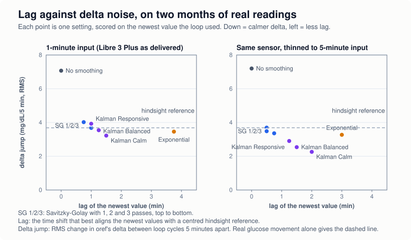
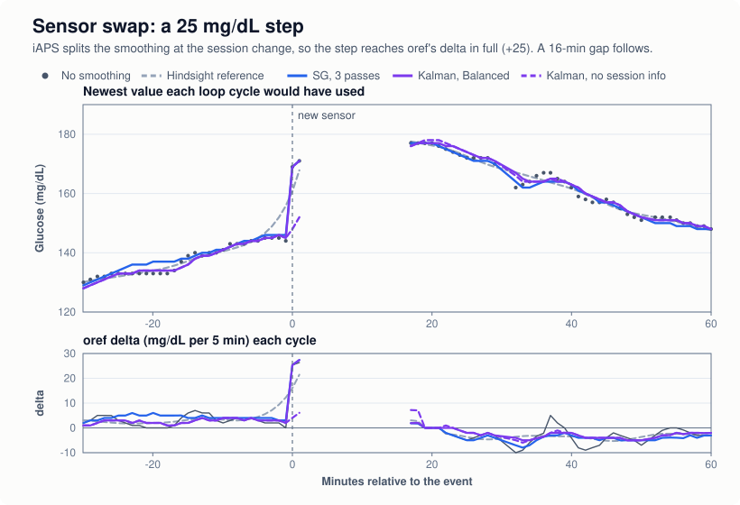

# Glucose smoothing: technical notes

User guide: [glucose-smoothing.md](glucose-smoothing.md)

For iAPS contributors and for people comparing the iAPS filters with AndroidAPS or Trio. It covers where smoothing
sits in the pipeline, what each filter computes, how they differ from the AndroidAPS originals, how they were evaluated
(on simulated and on real data), and what is still open. Everything here was checked against the code on
`feature/glucose-smoothing-improvements`. Line links point at that branch and are approximate.

Conventions used throughout:

- **Units.** Every filter works in mg/dL.
- **Order.** The glucose store and every `AppCoordinator` glucose stream are **newest → oldest**. The filters work
  **oldest → newest**. [`GlucoseSmoothing.smooth`](../FreeAPS/Sources/Helpers/GlucoseSmoothing.swift#L33) reverses on the
  way in and reverses back on the way out.
- **Minutes.** All time constants below are in minutes of clock time unless stated otherwise.

---

## 1. Data flow

### Where smoothing runs

Smoothing runs in exactly one place:
[`BaseGlucoseStorage.updateAppCoordinator()`](../FreeAPS/Sources/APS/Storage/GlucoseStorage.swift#L243). It never runs
inside OpenAPS, the JavaScript, or the UI.

```
 CGM plugin / Nightscout / manual entry
        │
        ▼
 GlucoseStorage.storeGlucose            drops an sgv reading that is within ±45 s of an existing sgv,
        │                                keeps 24 h, sorts newest → oldest, writes monitor/glucose.json
        ▼
 cachedGlucose  (raw, newest → oldest) ─────────────────────────────────────────────┐
        │                                                                            │
        │  settings.glucoseSmoothing.smoother == nil ?  ── yes ──► smoothed = raw    │
        ▼  no                                                                        │
 GlucoseSmoothing.smooth(cachedGlucose, using: smoother)                             │
        │   take sgv readings > 39 only (others pass through raw, outside the series)│
        │   sort by time; split into segments (gap > maximumGap, or session change)  │
        │   smoother.smooth(segment) per segment, oldest → newest                    │
        │   value outside 0…1000 or NaN → that reading stays raw                     │
        │   floor at 40, round to Int, write into BloodGlucose.glucose               │
        ▼                                                                            │
 smoothed  (all records, newest → oldest)                                            │
        │                                                                            │
        ├──► FrequentGlucoseFiltering(4.5 min) ──► frequencyFiltered                 │
        ▼                                                ▼                           ▼
 appCoordinator.glucoseSmoothed          appCoordinator.glucoseFrequencyFiltered   appCoordinator.glucoseRaw
   Home chart line                         oref0: determine-basal, meal/COB,         Nightscout, HealthKit,
                                           autosens, autotune, middleware,           data table, watch, Live
                                           autoISF `glucose`                         Activity, alarms, bolus
                                                                                     calculator, header BG/delta,
                                                                                     gap detection, calibrations
```

`updateAppCoordinator()` is called from
[`setCachedGlucose`](../FreeAPS/Sources/APS/Storage/GlucoseStorage.swift#L206). That covers every new reading, deletion,
recalibration and raw JSON edit. It is also called when `glucoseSmoothing` or `allowOneMinuteLoop` changes
([GlucoseStorage.swift:58-71](../FreeAPS/Sources/APS/Storage/GlucoseStorage.swift#L58)). Each call smooths the
**whole 24-hour cache from raw**. Nothing smoothed is persisted, and turning smoothing off takes effect on the next
recompute without touching stored data.

### What gets smoothed

- **Only CGM readings.** The driver smooths records with `type == "sgv"` and a raw value **> 39**
  ([`isSmoothable`](../FreeAPS/Sources/Helpers/GlucoseSmoothing.swift#L82)). Everything else passes through raw:
  error codes (38, xDrip's "calibration failed"), 39 (the Dexcom / Nightscout "LOW" sentinel), `Manual` fingersticks,
  `cal`, `mbg` and records with no type. These records are also **kept out of the series**: they do not split segments
  and do not pull on neighbouring readings. The Home chart's manual-BG dots therefore show raw values.
- **Only the level.** `setSmoothedValue` writes `BloodGlucose.glucose` and nothing else
  ([GlucoseSmoothing.swift:161](../FreeAPS/Sources/Helpers/GlucoseSmoothing.swift#L161)). The date, id, `direction`,
  `noise`, `uncalibrated` and `sessionStartDate` pass through unchanged.
- **Deltas are not smoothed separately.** oref0 and autoISF compute their deltas from the smoothed levels they receive.
  A filter therefore affects dosing in two ways: through the newest level, and through the levels 5–45 minutes back
  that the deltas difference against. Those older levels are as revised by the *current* run.
- **Output range.** A smoothed value outside `0…1000`, or NaN or infinite, is treated as a filter fault: that reading
  keeps its raw value, and one warning is logged per run. Everything else is **floored at 40** and **rounded to whole
  mg/dL** ([GlucoseSmoothing.swift:22-30, 67-71](../FreeAPS/Sources/Helpers/GlucoseSmoothing.swift#L22)).
- **Why 40.** The bundled JavaScript keeps only `glucose > 39` for its deltas, and determine-basal treats
  `bg <= 10 || bg === 38` as a CGM error (no low-suspend logic runs on it). A valid reading must never be smoothed into
  one of those. Without the floor, every method went below 40 when glucose fell onto a 40 plateau; Kalman on 1-minute data
  reached 37.8, which rounds to 38.

### What oref receives

[`OpenAPS.glucoseEntries`](../FreeAPS/Sources/APS/OpenAPS/OpenAPS.swift#L356) maps each `BloodGlucose` to a
`GlucoseEntry0`, with `sgv` and `glucose` both set to the (smoothed) `glucose` value. `noise` and `type` pass through
unchanged.

| oref input | source | spacing |
|---|---|---|
| `glucose` for determine-basal, meal/COB, autosens, autotune, middleware, autoISF | `glucoseFrequencyFiltered` ([OpenAPS.swift:317](../FreeAPS/Sources/APS/OpenAPS/OpenAPS.swift#L317)) | ≥ 4.5 min, anchored on the newest record |

The 5-minute stream is taken from the records **after** smoothing. On a 1-minute sensor the filters therefore see all
the 1-minute data, and oref receives roughly every fifth smoothed value. AndroidAPS works the other way round: it
resamples to 5 minutes first and smooths that.

Unchanged from alpha: `FrequentGlucoseFiltering` runs over **all** records, so the 5-minute stream can still start with
a manual entry or a 38 (now raw rather than smoothed). See §8.

### What the UI and integrations get

| consumer | stream |
|---|---|
| Home chart line | `glucoseSmoothed` ([HomeProvider.swift:63](../FreeAPS/Sources/Modules/Home/HomeProvider.swift#L63)). Raw dots are drawn on top while smoothing is on (`data.smooth`) |
| Home chart manual-BG dots | `glucoseSmoothed` filtered to `Manual` ([HomeProvider.swift:79](../FreeAPS/Sources/Modules/Home/HomeProvider.swift#L79)). Manual records are never smoothed, so these are raw |
| Home header BG and delta | raw ([HomeStateModel.swift:455-457](../FreeAPS/Sources/Modules/Home/HomeStateModel.swift#L455)) |
| Data table, Nightscout upload, HealthKit, watch, Live Activity, notifications, calendar, Shortcuts, bolus calculator, calibrations | `glucoseRaw` |
| Glucose alarms (`getAlarm`) | `cachedGlucose` (raw) |
| Gap detection (`GlucoseGap`, `APSManager`) | raw |

---

## 2. The common framework

[`GlucoseSmoothing.swift`](../FreeAPS/Sources/Helpers/GlucoseSmoothing.swift) has four parts: one protocol, one
driver, a shared helper (`initialSlope`) and the setting-to-filter mapping.

```swift
protocol GlucoseSmoother: Sendable {
    var maximumGap: TimeInterval { get }
    /// samples: oldest -> newest, no gap larger than `maximumGap`, all from one CGM session
    func smooth(_ samples: [GlucoseSample]) -> [Double]
}
```

**Selection and order.** The driver picks the smoothable records (sgv, > 39) and **sorts them by time** before
segmenting, because the filters run forwards in time. The store is already sorted unless edited by hand. Output is
written back to each record's own position, so the caller's order is kept.

**Segmentation** ([`segments(of:maximumGap:)`](../FreeAPS/Sources/Helpers/GlucoseSmoothing.swift#L88)). The driver
splits the series wherever:

- consecutive readings are more than the filter's `maximumGap` apart, or
- the sensor session changes. Each reading is compared with the **last non-nil `sessionStartDate` seen in the current
  run**, not just with its neighbour, using
  [`BloodGlucose.isSameSession`](../FreeAPS/Sources/Models/BloodGlucose.swift#L253): two stamps within 30 minutes
  (`sessionTolerance`) are the same session. A reading with no stamp (Nightscout backfill) joins the current run, but it
  can no longer **bridge** two sensors: sensor A, an unstamped reading, then sensor B still splits at B. The tolerance
  absorbs session stamps that jitter (iAPS issue #1806).

Each segment is smoothed on its own, so a filter's state never crosses a gap or a sensor change. This gives every filter
the same sensor-change behaviour without each one implementing it.

**Fallbacks to raw.** Two, both logged:

- a smoother returns a different number of values than it was given → the whole segment stays raw;
- a returned value is NaN, infinite, negative or above 1000 → that reading stays raw (one warning per run).

None of the filters throw.

**`initialSlope`** ([GlucoseSmoothing.swift:116](../FreeAPS/Sources/Helpers/GlucoseSmoothing.swift#L116)) is the
least-squares slope (mg/dL/min) of the readings > 39 within the first 10 minutes of a segment. It returns `nil` when
they span less than 3 minutes. Kalman and Exponential use it to seed their trend (§3.2, §3.3). A two-point difference is
much noisier: on a 1-minute sensor it is one minute of noise.

**Mapping** ([GlucoseSmoothing.swift:145](../FreeAPS/Sources/Helpers/GlucoseSmoothing.swift#L145)):

| `algorithm` | smoother | `maximumGap` |
|---|---|---|
| `off` | `nil` (raw passes through) | — |
| `savitzkyGolay` | `SavitzkyGolayFilter(passes:)` | 15 min |
| `kalman` | `KalmanFilter(responsiveness:)` | 60 min |
| `exponential` | `ExponentialFilter()` | 12 min |

---

## 3. The algorithms

### 3.1 Savitzky–Golay

[`SavitzkyGolayFilter.swift`](../FreeAPS/Sources/Helpers/SavitzkyGolayFilter.swift)

**Model.** For each reading, the filter fits a quadratic `y = a + b·x + c·x²` by least squares to the readings in a
window, then evaluates the fit at that reading's own time. Both the abscissa and the window are **real time**, not array
positions:

- The window is `[centre − h, centre + h]`, inclusive, with half-width **`h = 16.25 min`**. At a 5-minute cadence that is
  7 readings; at a 1-minute cadence, 33.
- `h` is deliberately not a whole number of readings. On an exact grid, 16.25 minutes puts every window edge 1.25 minutes
  from the nearest 5-minute reading (15 s from the nearest 1-minute one), so timestamp jitter cannot move a reading across
  an edge. At exactly 15 minutes the outermost readings sat on the edges, and real 5-minute timestamps (±1 s) flipped
  windows between 6 and 7 readings. With ±10 s of jitter the output now moves by under 0.5 mg/dL; it moved by up to 7.3
  before.
- `x = (t − centre) / h`, so `x` stays in [−1, 1] and the fourth moment stays well conditioned.
- With uneven spacing the odd moments no longer cancel. The filter therefore solves the full 3×3 normal equations through
  the adjugate of the moment matrix ([`onePass`](../FreeAPS/Sources/Helpers/SavitzkyGolayFilter.swift#L105)), not the
  classic fixed convolution coefficients. At 5 minutes, interior output still equals the legacy 7-point kernel
  `[-2, 3, 6, 7, 6, 3, -2]/21`.

**Edges, including the newest point.** Near either end the window **slides inwards**: centre `first + h` or `last − h`
([`windows`](../FreeAPS/Sources/Helpers/SavitzkyGolayFilter.swift#L58)). A slid window takes the end sample itself as
its edge (`[first, first + 2h]` or `[last − 2h, last]`) rather than recomputing the edge from the centre, so floating-point
rounding cannot leave the first or the newest reading out of its own window. The newest reading is therefore evaluated at
the trailing edge of a full window that ends at that reading (`x = +1`). No points are invented. If a whole segment spans
no more than `2h`, every reading is fitted against all of them, with the centre at the midpoint.

**Gaps and uneven spacing.** Missing readings just make a window sparser, and timestamp jitter just moves `x`. A window
with fewer than 4 readings leaves that value as it came out of the previous pass, which is raw on the first pass. So does
a near-singular moment matrix, where `det ≤ 1e-9·s0³` and only near-coincident timestamps can cause it. Segments split at
gaps over 15 minutes. Error codes never reach the filter (§2).

**Passes.** Each pass refits the previous pass's output over the same windows. More passes widen the effective kernel:
with 3 passes at 5 minutes, the newest value depends on the last 13 readings.

| parameter | default | rationale |
|---|---|---|
| half-width `h` | 16.25 min | 7 readings at 5 minutes (the old window), 33 at 1 minute; edges clear of jittered readings |
| passes | 3 (settable 1–3) | The old implementation always ran 3 |
| minimum readings per window | 4 | A quadratic fit needs at least 3 |
| `maximumGap` | 15 min | |

**Newest-point behaviour (derived).** The filter is linear, so its response at the newest point on a uniform cadence
follows directly from its weights. The table below was computed by building the filter's weight matrix exactly as the
Swift does (impulse responses through an independent transcription of the Swift) and raising it to the number of
passes. "Noise gain" is output σ divided by input σ for white noise.

| cadence | passes | noise gain, newest point | noise gain, interior | lag on a linear or quadratic trend |
|---|---|---|---|---|
| 5 min | 1 | 0.873 | 0.577 | 0 |
| 5 min | 2 | 0.855 | 0.515 | 0 |
| 5 min | 3 | 0.845 | 0.488 | 0 |
| 1 min | 1 | 0.492 | 0.261 | 0 |
| 1 min | 3 | 0.463 | 0.219 | 0 |

A quadratic evaluated at the edge of its own window has no lag on any curve the quadratic can represent, but it removes
far less noise at the newest point than in the middle of the window. At 5 minutes, extra passes barely change the newest
point. They mostly change the history. On real data the edge evaluation has a cost that this table does not show: at a
turn, the edge of the fit extrapolates the old direction, and the newest-point trend is the least reliable of the options
(§5, *Real readings*).

**Compared with the old implementation** (`smoothSavitzkyGolayQuaDratic(withFilterWidth: 3)`, removed in `0444ee0cd`):

- The old filter convolved fixed 7-point coefficients `[-2, 3, 6, 7, 6, 3, -2]/21` over **array positions**. At 5
  minutes, for interior points away from gaps, it gives the same fit as the new one.
- To reach the ends, it padded the array with 3 points on each side, extrapolated from a linear regression through the
  first or last 3 readings. The newest values therefore depended on invented points.
- After every pass it wrote back with `Int(newValue)`, which **truncates** rather than rounds. Three passes biased the
  result downwards; on two months of real readings the median bias was −1.4 mg/dL. The new code keeps `Double` between
  passes and rounds once at the end.
- On a 1-minute sensor its 7-reading window covered ±3 minutes, and barely smoothed (the oref delta's cycle-to-cycle
  jump was 6.98 against 7.07 raw on real data). The new window covers ±16.25 minutes, so a user who had the old switch on
  with a 1-minute source now gets much stronger smoothing.
- It ignored gaps and sensor sessions, and was off by 6–14 mg/dL on the first cycle after a 10–12 minute gap on real
  1-minute data. The new filter is segmented.

### 3.2 Kalman

[`KalmanFilter.swift`](../FreeAPS/Sources/Helpers/KalmanFilter.swift)

Adapted from AndroidAPS's `UnscentedKalmanFilterPlugin`. The constants are those of the nightscout/AndroidAPS `dev`
version (`efd1a3c417`), as ported in the smooth-sandbox and not checked against the Kotlin source. The autoISF fork's
version is tuned differently (see the comparison below).

The state is `x = [G, Ġ]`: glucose in mg/dL, and its rate in mg/dL/min. A local level-and-trend model runs forward,
followed by a Rauch–Tung–Striebel (RTS) backward pass.

**Process model** ([`predict`](../FreeAPS/Sources/Helpers/KalmanFilter.swift#L215)), with `Δt` the real interval in
minutes:

```
F = [[1, Δt], [0, d]],   d = exp(−Δt / 30)
x⁻ = F·x
P⁻ = F·P·Fᵀ + Q·(Δt / 5),   Q = diag(q_G, q_Ġ)·responsiveness
```

- The rate decays with a 30-minute time constant, so a trend the readings no longer support cannot extrapolate
  indefinitely.
- `Q` is quoted per 5 minutes and scaled linearly with `Δt`, so a 1-minute and a 5-minute sensor see the same process
  noise per unit of clock time.
- `Q` is diagonal on purpose, as in AndroidAPS, where these values came from. The textbook constant-velocity form would
  add a cross term and change what the defaults mean.
- Intervals are floored at 0.1 min so that coincident or out-of-order timestamps cannot make `F` degenerate.

**Measurement update** ([`update`](../FreeAPS/Sources/Helpers/KalmanFilter.swift#L234)). The measurement is scalar
(`H = [1, 0]`), so `K = P⁻[·,0] / (P⁻₀₀ + R)`. The rate is clamped to ±4 mg/dL/min, and both variances are floored.

**Robustness.** Let `ν̃ = ν / √(P⁻₀₀ + R)` be the normalised innovation, and `s = |ν̃|`.

- *Outlier down-weighting (Huber-style).* `R_eff = min(R·(1 + max(0, s − 2)), min(R + 100, 400))`. Trust in a reading
  falls linearly beyond 2σ. The `R + 100` ceiling stops a single wild value from making the filter deaf.
- *Trend detection.* For each of the last three readings, the filter records the innovation's sign if it exceeded 2σ,
  and 0 if it did not. The current reading is one of the three. If at least two of the three match the current
  innovation's sign, it treats the move as real and re-predicts with inflated process noise:
  `q_G·min(k, 2)` and `q_Ġ·k`, with `k = clamp(max(s, 1), 1, 3)`. The inflated prediction is the one stored for the RTS
  pass.
- *Error codes.* The filter still predicts through a reading ≤ 38 and writes the raw value back, and it skips leading
  error codes ([`smooth`](../FreeAPS/Sources/Helpers/KalmanFilter.swift#L65)). In the app this is unreachable, because the
  driver removes everything ≤ 39 before smoothing (§2).

**Measurement noise R** ([`estimateMeasurementNoise`](../FreeAPS/Sources/Helpers/KalmanFilter.swift#L315)). R is
estimated **once per segment, from the readings themselves**:

1. For each interior reading, compute the residual from the straight line through its two neighbours, using real
   timestamps. Divide by `√(1 + (1−w)² + w²)`, where `w` is the interpolation weight, so that every residual has variance
   σ² whatever the spacing.
2. σ = 1.4826 × the median absolute deviation (MAD) of the residuals. R = σ², clamped to [16, 225].
3. Fewer than 30 usable residuals → R = 25.

On the real data in §5 (a Libre 3 Plus at 1 minute and an unidentified 5-minute source), σ was about 0.6 mg/dL in every
24-hour window, so R ≈ 0.36, far below the floor of 16. **The floor always binds on those sensors.** There, Kalman
behaviour is set entirely by the R floor and the Q preset.

**Initialisation.** The filter starts at the **first valid reading** (> 38), at `G = v₀`. The rate is seeded from
[`initialSlope`](../FreeAPS/Sources/Helpers/GlucoseSmoothing.swift#L116) over the first 10 minutes (needs a span of at
least 3 minutes, otherwise 0), clamped to ±4 mg/dL/min. `P = diag(16, 1)`. Previously the rate was a single two-point
difference. On 1-minute data that made the newest values just after a segment start noisier than the raw readings. With
the fitted slope the newest value's noise is about 0.8× raw at the 4th reading and about 0.44× by the 20th. On the real
data in §5 this changed the newest level in 18 of 84,065 loop cycles, by at most 3 mg/dL, all of them right after a gap or
a sensor change.

**Backward pass** ([`backwardPass`](../FreeAPS/Sources/Helpers/KalmanFilter.swift#L256)). This is the standard RTS
smoother, `C = P·Fᵀ·(P⁻_{k+1})⁻¹`, applied to the mean only, because nothing downstream uses the smoothed covariance. The
gain uses the covariance **as clamped** before each prediction (`P₀₀ ∈ [0.1, 400]`, `P₁₁ ∈ [0.001, 4]`), which is the
one the prediction actually started from. The newest sample has no future, so it **stays as filtered**. Only the forward
filter affects the newest point.

| constant | value | notes |
|---|---|---|
| `q_G`, `q_Ġ` | 1.0, 0.35 per 5 min | × `responsiveness` |
| `responsiveness` | Calm 0.7, **Balanced 1.0**, Responsive 1.5 | [`KalmanResponsiveness.processNoiseScale`](../FreeAPS/Sources/Models/FreeAPSSettings.swift#L1109). Balanced is the default tuning |
| rate decay τ | 30 min | |
| R initial / min / max / effective max | 25 / 16 / 225 / 400 | mg/dL² (σ ≈ 5 / 4 / 15 / 20) |
| outlier threshold | 2σ | |
| max rate | ±4 mg/dL/min | |
| initial rate | least-squares slope over 10 min, ≥ 3 min span, else 0 | |
| P₀₀ range, P₁₁ range | [0.1, 400], [0.001, 4] | |
| minimum segment | 3 valid readings | fewer → raw |
| `maximumGap` | 60 min | |

**Compared with AndroidAPS.** Two upstream versions of `UnscentedKalmanFilterPlugin.kt` exist:

- the **autoISF fork** (`T-o-b-i-a-s/AndroidAPS`, branch `3.4.2.6+aisf3.2.1`), checked out at
  `../AndroidAPS-aisf/plugins/smoothing/`. It is tuned differently: rate process noise 0.40, R maximum 196, an extra
  0.98 rate damping per reading, chi-squared outlier scaling, and Δt clamped to [3.5, 6.5]; and
- **AAPS dev** (`nightscout/AndroidAPS@dev`, commit `efd1a3c417`). This is the version the iAPS constants follow
  (`q_Ġ = 0.35`, R max 225, τ = 30 in the transition, Huber from 2σ, two of three signs at 2σ).

AAPS dev is not checked out next to this repo. What follows about it comes from the sandbox's port (`aaps-ukf.ts`,
variant `dev`) and from the comments in `KalmanFilter.swift`. I compared the fork directly.

| aspect | AndroidAPS | iAPS | why |
|---|---|---|---|
| Filter form | UKF with sigma points | Plain linear KF | Both models are linear, so the unscented transform is exact and adds nothing. The sandbox's parity check gives max difference 1.8e-12 against its AAPS dev port once R is matched |
| Input | 5-min bucketed data; Δt clamped to [3.5, 6.5] (fork) | Raw readings, real Δt | iAPS smooths before resampling |
| Rate decay | fork: × 0.98 per reading; dev: exp(−Δt/30) | exp(−Δt/30) | Time-based. Matches dev; about 8× stronger than the fork (equivalent τ ≈ 247 min) |
| R | Learned online from innovations, persisted across runs. Fork: median plus 6% step. Dev: 20% trimmed mean | Batch MAD of neighbour residuals, per segment, not persisted | Online estimation is circular. A symmetric 20% trimmed mean of χ²(1) reads 0.576 of the true mean (checked numerically), which pins R at its floor. Repeatable from the data alone |
| Outliers | fork: R × max(1, ν̃²/15.13), from about 3.9σ, quadratic | Linear from 2σ, capped at R + 100 | Same as dev |
| Q inflation gate | fork: 2 consecutive same-sign at 3σ | 2 of the last 3 at 2σ | Same as dev |
| Segmentation | Splits on > 60 min, on < 2 min (!), and on every 38 | Splits on > 60 min or session change; error codes never reach it | A 1-minute sensor would split at every reading under the AAPS rule |
| Initial rate | Seeded only if the first Δt is 3–7 min | Least-squares slope over the first 10 min | |
| Minor gaps (7–60 min) | Extra covariance inflation and rate damping | The normal single predict step | |
| Sensor change | Resets learned R on a SENSOR_CHANGE therapy event, before segmenting | Splits at the session boundary; resets R, x and P | |
| Output floor | 39 | 40 (driver) | §1 |

### 3.3 Exponential

[`ExponentialFilter.swift`](../FreeAPS/Sources/Helpers/ExponentialFilter.swift)

A fixed blend of first-order exponential smoothing and Holt's second-order (level plus trend) smoothing. The constants
are AndroidAPS's (`ExponentialSmoothingPlugin`):

```
step  = max(Δt / 5 min, 0.1 / 5)                     (reference interval: 5 min; Δt floored at 0.1 min)
α₁'   = 1 − (1 − 0.5)^step
α₂'   = 1 − (1 − 0.4)^step
β'    = min(step, 1 − (1 − 1.0)^step) = min(step, 1)

L     ← L + α₁'·(v − L)                              first order
H_prev = H
H     ← α₂'·v + (1 − α₂')·(H + T·step)               Holt level; T is held per 5 min
T     ← β'·(H − H_prev)/step + (1 − β')·T            Holt trend
out   = 0.4·L + 0.6·H
```

The filter is **causal**. There is no backward pass, so a value is never revised, and retrospective and online
evaluation give identical results.

**Initialisation** ([`initialTrend`](../FreeAPS/Sources/Helpers/ExponentialFilter.swift#L109)). `L = H = v₀`. The trend
`T` is held per 5 minutes:

- if the first interval is ≥ 4 min (0.8 reference intervals), `T = (v₁ − v₀) / step₁`. That is AndroidAPS's first
  difference, so output on a 5-minute sensor is unchanged;
- otherwise `T = 5 × initialSlope` over the first 10 minutes (0 if the span is under 3 minutes). On a 1-minute sensor
  the literal per-step version is one minute of noise multiplied by five, and the β cap keeps it around for many
  readings. In simulation the newest value then came out about 3× noisier than the raw readings for the first 10–15
  minutes of a segment.

On the real data in §5 this changed the newest level in 70 of 84,065 loop cycles, by at most 4 mg/dL, all of them at a
segment start.

**Time conversion.** AndroidAPS applies its factors once per reading. On a 1-minute sensor that would make the filter's
time constant about 1.4 minutes instead of about 7.2. iAPS compounds `1 − α` over the real interval instead. At
`step = 1` every factor is exactly the AndroidAPS value.

**The β cap.** With `β = 1`, nothing survives one interval, so compounding cannot shrink it: `1 − 0^step = 1` for every
`step > 0`. Without the cap, the trend on a 1-minute sensor would be one minute of noise scaled up 5×. Capping β' at
`step` limits how fast the trend can refresh. At 5 minutes the cap equals 1, which keeps 5-minute output bit-identical.
The sandbox check `exponential.ts` asserts exactly that (max difference 0). The code comment cites a real Libre 3 day: 32
visible reversals in the raw data, 36 after uncapped smoothing, 4 with the cap. I could not re-derive that number, because
that dataset is not in the repo.

**Duplicate timestamps.** Δt is floored at 0.1 min, as in the Kalman filter, so a reading with a duplicate timestamp
gets a smoothed value instead of being left raw.

**Error codes and gaps.** The filter still contains AndroidAPS's rule: smoothing starts after the most recent reading
≤ 38 in the segment, and everything up to it passes through raw. In the app that rule never triggers, because the driver
removes everything ≤ 39 before smoothing (§2), so a 38 no longer restarts the filter. At least 4 readings are needed;
otherwise the segment stays raw. Segments split at gaps over 12 minutes.

| constant | value | AndroidAPS |
|---|---|---|
| first-order weight | 0.4 | 0.4 |
| α₁ (first order) | 0.5 per 5 min | 0.5 per reading |
| α₂, β (Holt) | 0.4, 1.0 per 5 min | 0.4, 1.0 per reading |
| initial trend | first difference if first Δt ≥ 4 min, else fitted slope | first difference |
| minimum readings | 4 | 4 |
| `maximumGap` | 12 min (split if > 12) | split if `round(Δt) ≥ 12` |
| output floor | 40 (driver) | 39 |

The other differences from AndroidAPS:

- AndroidAPS smooths only the **newest** gap-free window, and older bucketed values keep no smoothed value. iAPS smooths
  every segment in the 24-hour history. This matters for the chart, autosens and COB, not for the newest point.
- AndroidAPS runs on 5-minute bucketed data. iAPS runs on the raw readings.

---

## 4. Edge cases and safety

| situation | behaviour |
|---|---|
| **Gap** | Split at `maximumGap` (15 / 60 / 12 min). Within a segment: SG windows get sparser; Kalman takes one large predict step with matching uncertainty; Exponential compounds its factors over the real interval |
| **New sensor / sensor change** | Split when `sessionStartDate` differs by more than 30 min from the last stamp seen in the run. An unstamped reading joins the current run but cannot bridge two sensors. A gapless swap on a source that reports no session (e.g. Nightscout) is **not** detected. Warm-up readings are smoothed like any others; there is no warm-up model. oref's delta still compares across the change (§8) |
| **Very short segment** | SG < 4 readings, Kalman < 3, Exponential < 4 → raw. Kalman R falls back to 25 below 30 residuals |
| **Outlier / spike** | Kalman: Huber down-weighting from 2σ. SG and Exponential: no special handling; a spike spreads over the window, or into the running level and trend |
| **Compression low** (several low readings) | Kalman's 2-of-3 gate eventually treats it as a real move. Its Huber weighting first locks out for part of the dip (§5). No method detects compression lows specifically. On real data SG's newest value undershot fast V-shaped dips by up to 20 mg/dL (§5) |
| **Error codes (≤ 39)** | Never smoothed by any method. They pass through raw and are kept out of the series, so they neither split segments nor disturb neighbours |
| **Manual / cal / mbg / untyped records** | Never smoothed; pass through raw and are kept out of the series |
| **Duplicates** | The store drops an sgv within ±45 s of an existing sgv. Kalman and Exponential floor Δt at 0.1 min. SG handles coincident times through the determinant guard |
| **Out of order** | The driver sorts the smoothable readings by time before segmenting; output keeps the caller's order. The store is also sorted on every write; only a raw JSON edit can leave it unsorted |
| **Units** | All mg/dL internally. mmol/L users are unaffected except that output is rounded to whole mg/dL (about 0.06 mmol/L) |
| **Output range** | Outside `0…1000` or non-finite → raw (logged). Otherwise `max(value, 40)`, then `Int(value.rounded())` |
| **Failure** | Count mismatch → segment raw; implausible value → reading raw. The filters do not throw |
| **Off** | `smoother == nil`: raw passes through untouched, and the 5-minute stream is built from raw |

---

## 5. Evaluation

### Online versus retrospective

The loop never sees the chart's smoothed line. Every five minutes it sees **the series as smoothed from the data that
existed at that moment**. For a filter with a backward pass (Kalman RTS, centred SG), those two series differ:

- The **newest point** has no future data. It is pure forward filter, or a window evaluated at its edge.
- Points 5–45 minutes back, which oref differences the newest point against for `delta`, `short_avgdelta` and
  `long_avgdelta`, have only 5–45 minutes of future data. They are partly retrospective.
- Points hours back (autosens, COB deviations) are effectively fully retrospective.

A fair evaluation for dosing is therefore **walk-forward**: for each time `t`, re-run the filter on the readings up to
`t`, and compute each quantity (level, deltas) **inside that prefix**. Scoring the retrospective line, or
differencing the assembled newest-only series, both get it wrong.

### What the sandbox measured (simulated data)

The sandbox is `smooth-sandbox`, a TypeScript app that lives **outside this repo**
(`../smooth-sandbox`). It ports every iAPS, AndroidAPS and Trio-Tai filter. Signals are synthetic: a true curve plus a
seeded sensor model. Below are its own generated outputs (`.check/out/section10.txt`, `.check/out/deviations.txt`). Run
`.check/section10.ts` or `.check/deviations.ts` to reproduce them. They were produced before the fix pass (§3); the
changes there (SG half-width 16.25, trend seeding) move these simulated figures little, but they have not been
regenerated.

**Realistic day, sensor σ = 8 mg/dL, 5-minute cadence, 5-minute delta, mean of 10 seeds** (`section10.txt`):

| filter | mode | level RMSE | delta RMSE | lag (min) | sign flips |
|---|---|---|---|---|---|
| Kalman (Balanced) | retrospective | 3.70 | 1.69 | 0.9 | 12% |
| Kalman (Balanced) | **online** | 5.63 | 2.45 | 3.2 | 22% |
| Savitzky–Golay, 3 passes | retrospective | 4.17 | 2.14 | 0.6 | 19% |
| Savitzky–Golay, 3 passes | **online** | 6.93 | 4.23 | 0.8 | 30% |
| Exponential | retrospective | 5.62 | 4.28 | 3.1 | 31% |
| Exponential | **online** | 5.64 | 4.26 | 3.1 | 31% |
| AAPS UKF (fork) | retrospective | 3.95 | 1.94 | 1.1 | 15% |
| AAPS UKF (fork) | **online** | 5.84 | 2.76 | 2.8 | 25% |
| raw | — | 8.17 | 11.49 | — | 41% |

What this shows:

- **Retrospective numbers flatter the backward-pass filters.** On delta RMSE, Kalman goes from 1.69 retrospective to 2.45
  online (×1.45), and SG from 2.14 to 4.23 (×2). Exponential is identical in both modes, which is the check that the
  walk-forward harness behaves as intended.
- **Online, Kalman has the best deltas** (2.45, against about 4.2 for SG and Exponential). Kalman and Exponential tie on
  level (5.63 / 5.64).
- **SG has the least lag but removes the least noise at the newest point**, as §3.1 predicts: level 6.93 online against
  8.17 raw, a ratio of 0.85, matching the derived 0.845.

> **Superseded figures.** The sandbox README's own "Online vs retrospective" table, and notes that quote it, say that
> online "the causal exponential filter does best" and that retrospective evaluation flatters by "roughly 3x". Those
> numbers came before a fix in `section10.ts`, which computes the rate inside each prefix instead of differencing the
> assembled online series ("Getting this wrong understated every filter with a backward pass"). The table above is the
> current output.

**Kalman, iAPS versus AndroidAPS** (`deviations.txt`, walk-forward, mean of 8 seeds). "iAPS" means AAPS dev plus the
batch MAD R estimate.

| dataset | AAPS dev level / lag | fork level / lag | iAPS level / lag |
|---|---|---|---|
| realistic day, σ 1 | 1.08 / 1.3 | 1.00 / 0.8 | 1.08 / 1.3 |
| realistic day, σ 4 | 3.22 / 1.9 | 3.26 / 1.2 | 3.21 / 1.9 |
| realistic day, σ 8 | 5.83 / 3.1 | 6.01 / 2.1 | 5.63 / 3.5 |
| single +45 outlier | 1.97 / 1.6 | 2.37 / 1.0 | 1.97 / 1.5 |
| compression low | 4.53 / 2.7 | 2.38 / 0.9 | 4.29 / 2.5 |

The iAPS/dev design (Huber from 2σ, rate decay τ = 30) is quieter on noise and single outliers, and pays for it with
0.5–1.4 minutes more lag. It does clearly worse on a **sustained** compression low: it down-weights the whole dip, coasts
on a stale rate, and then has to catch up.

**AndroidAPS bucketing.** `createBucketedData5min` (`AutosensDataStoreObject.kt` in the fork):

- **linearly interpolates gaps of more than 8 minutes** in 5-minute steps, marking them `filledGap`;
- keeps readings 2–8 minutes apart;
- averages readings that are closer than that into one bucket;
- snaps the result onto a 5-minute grid.

`elapsedMinutes` is a `Long` (whole-minute) division, so in practice a gap needs ≥ 9 minutes to be filled, and a reading
needs ≥ 3 minutes to start a new bucket. Data that is not "about 5-minute" (`isAbout5minData`, e.g. a 1-minute CGM), or
a grid adjustment over 90 seconds, goes through `createBucketedDataRecalculated` instead. That routine interpolates every
5-minute grid point from the bracketing readings, anchored at the newest reading, so on a 1-minute sensor bucketing alone
leaves the newest value equal to the raw reading. AndroidAPS's smoothing plugins only ever see that grid. Comparing an
AndroidAPS filter with an iAPS one on the same raw readings is therefore not like-for-like. The sandbox applies bucketing
to the AndroidAPS filters only, and it is on by default. Its port uses fractional minutes, a small difference from the
Kotlin that matters only on irregular 5-minute data.

### Real readings

Two months of one person's **Libre 3 Plus** at 1-minute cadence (LibreLoop), plus a month from an earlier,
**unidentified 5-minute source**, taken from Nightscout. That is one person and one sensor family; treat these as
examples, not population results.

**Data.**

- The uploaded values are raw: the branch uploads `glucoseRaw`, and 1,971 log readings matched Nightscout exactly.
- 14 hours where an old 5-minute stream and the new 1-minute sensor were interleaved were excluded.
- Session starts for the last two sensors were recovered from the LibreLoop lifecounts, so the session split is
  reproduced.
- The 1-minute stream arrives already smoothed by the sensor. Diff-autocorrelation is +0.73 (independent noise would sit
  near −0.5), and the neighbour-residual σ is 0.6 mg/dL. There was **no isolated single-reading spike of 8 mg/dL or
  more in 60 days**.

**Harness.**

- The sandbox iAPS ports, updated to the fixed Swift, were cross-checked against an independent transcription of the
  Swift on 12 hand and real cases: max difference 1.3e-8 mg/dL, no value rounding differently.
- They were driven by a pipeline that reproduces the branch exactly: a 24-hour history, the driver (sgv > 39, sorting,
  sessions, floor 40, rounding), `FrequentGlucoseFiltering` at 4.5 min, and `glucose_status` from the **bundled**
  `glucose-get-last-autoisf.js`, unmodified.
- Every reading is one loop cycle (84,065 on the 1-minute data).
- There is no ground truth. The reference is a centred hindsight curve: a tricube-weighted local quadratic over
  ±15 min of the raw readings, fed through the same oref code. Re-running with ±8 and ±25 min references changes raw's
  own scores (the reference is built from raw) but **not the order between the smoothing options**.
- The scripts and full tables are outside the repo, in the analysis workspace.

**1-minute Libre 3 Plus, newest point as the loop used it:**

| method | lag (min) | \|offset\| median / p90 (mg/dL) | `delta` RMSE (mg/dL/5 min) | `delta` jump between cycles | wrong `delta` sign | turn seen after, median / p90 (min) |
|---|---|---|---|---|---|---|
| hindsight reference | 0 | 0 / 0 | 0 | 3.69 | 0% | 3 / 3 |
| No smoothing | 0 | 0.80 / 2.6 | 2.90 | **7.07** | 6.3% | 4 / **18.8** |
| SG, 1 pass | 0.75 | 1.71 / 5.5 | 4.45 | 4.02 | 15.3% | 8 / 9.6 |
| SG, 3 passes | 1.0 | 1.97 / 6.3 | **4.93** | 3.68 | **18.2%** | 8 / 10.6 |
| Kalman, Calm | 1.5 | 1.09 / 3.5 | 2.73 | 3.22 | 8.2% | 7 / 9 |
| Kalman, Balanced | 1.25 | 1.02 / 3.3 | 2.49 | 3.54 | 6.8% | 7 / 9 |
| Kalman, Responsive | 1.0 | 0.95 / 3.0 | **2.26** | 3.93 | 5.6% | 6 / 8.6 |
| Exponential | **3.75** | 2.49 / **7.9** | 3.69 | 3.46 | 13.1% | 8 / 9 |
| old SG (alpha) | 0 | 1.58 / 3.7 (bias −1.4) | 2.90 | 6.98 | 6.5% | 4 / 18 |

Column definitions:

- *Lag*: the best time shift aligning the newest values with the reference.
- *Wrong sign*: share of cycles with \|reference delta\| ≥ 2 where `delta` points the other way.
- *Turn seen after*: time from a reference turning point (≥ 20 mg/dL each side; 195 of them) until `delta` takes the new
  sign and keeps it for 10 minutes.

Thinned to 5-minute input, the same sensor gives the same order:

| | No smoothing | SG 1 / SG 3 | Kalman Calm / Balanced / Responsive | Exponential |
|---|---|---|---|---|
| `delta` RMSE | 3.00 | 3.66 / 4.16 | 3.16 / 2.85 / 2.52 | 3.00 |
| lag (min) | — | — / 0.75 | — / 1.5 / — | 3.0 |

Kalman Balanced and Calm need one more cycle to see a turn there (10 min median). The earlier 5-minute source also gives
the same order (`delta` RMSE: raw 1.21, SG 3 2.39, Kalman Balanced 1.58 / Responsive 1.36, Exponential 1.67).



**What it shows, by relevance to dosing:**

1. **On this pre-smoothed sensor no option improves the level oref doses from; they only calm the trend.** Raw's newest
   value is within 0.8 mg/dL (p90 2.6) of the reference. Raw's `delta` jumps 7.1 mg/dL/5 min between cycles and
   reverses 73 times a day against 42 for the reference; every option brings that to 3.2–4.0 and 41–48 a day.
2. **Kalman has the best trend; on this clean sensor Responsive is the best Kalman.**
   - It has the lowest `delta` and `short_avgdelta` error at every reference width.
   - Its wrong-sign rate is at raw's level, and its lag is 1–1.5 min.
   - In 85 fast rises (≥ 2 mg/dL/min for at least 15 min), Balanced read 2.1 mg/dL low (p90 5.7) and under-read
     `delta` by 2.1.
3. **SG's newest-point trend is the least reliable option.** The cause is extrapolation at the window edge, not lag
   (its lag is 0.75–1.0 min).
   - Wrong-sign rate by reference \|delta\| band 2–4 / 4–7 / 7–12 / ≥ 12 mg/dL per 5 min:
     - SG 3: 26 / 16.5 / 10.5 / 6.1%
     - raw: 12 / 4.1 / 1.0 / 0.2%
     - Kalman Balanced: 12.5 / 4.4 / 1.7 / 0.9%
   - More passes give a calmer but less accurate `delta`.
   - Its `delta` RMSE is worse than raw's at every reference width.
   - In 51 fast V-shaped dips (≥ 20 mg/dL, recovered within about 35 min; 27 at night, likely compression or sensor
     dips), SG 3's newest value went below the lowest raw reading by a median of 4, p90 9, max 20 mg/dL. Kalman: 1 / 3 /
     5. Exponential: 1 / 5 / 10. Reading low is the safe direction in a low, but it exaggerates exactly the artifacts
     that cause false lows.
4. **Exponential has the most lag.** It is 3.75 min on 1-minute input and 3.0 min on 5-minute input. In fast rises its
   level is a median of **9.5 mg/dL below** the reference (p90 16). Its `delta` RMSE (3.69) is worse than raw's.
5. **The session split does not protect oref's delta.** At the last sensor swap the new sensor read 25 mg/dL higher.
   Every method, with the split, gave `delta` ≈ +25 on that cycle. The same Kalman without session information gave +6.
   The new sensor's first 12 hours were 41% noisier than the rest.



6. **Gaps.**
   - In the 1-minute data (6 gaps of 10–16 min), Kalman stayed within 4 mg/dL on the first cycle after a gap; SG 3 was
     off by up to 9, and Exponential once by 11.
   - The 5-minute source has 235 gaps. First cycle after a gap, median / p90 / max error: raw 0.4 / 1.2 / 5.9, SG 3 0.5 /
     1.8 / 7.2, Kalman 0.8 / 2.7 / **19.2**, Exponential 1.2 / 4.7 / 13.1.
   - Kalman's worst case is a V-turn hidden in a 15-minute gap: it carries its trend across.

What moved with the fix pass, on this data:

- SG only, because of the 16.25-minute half-width: `delta` RMSE 4.77 → 4.93 and wrong sign 17.1 → 18.2% at 3 passes;
  slightly calmer (jump 3.93 → 3.68).
- Kalman and Exponential aggregates did not change. The seeding only acts at a segment start.
- The 40 floor never bound, because the lowest reading was 49.

**Limits.** No ground truth, so this measures closeness to a hindsight curve, not accuracy. It cannot see sensor bias,
drift or the sensor's own delay, cannot tell real fast moves from artifacts, and replays no doses.

### Newest-point lag and noise (derived from the code)

For a quick lag/noise picture without a dataset, the forward filters can be linearised: no outliers, a fixed R, and an
input with no gaps. The figures below come from a short transcription of the Swift forward passes (before the SG
half-width change; the SG 5-minute row is unchanged, and its 1-minute noise gain is now 0.463, see §3.1). "Ramp lag" is
how far behind the output sits on a steady 1 mg/dL/min ramp, in minutes. "Noise gain" is output σ divided by input σ for
white noise, from the exact impulse response at the newest point.

| filter | 5-min: ramp lag / noise gain | 1-min: ramp lag / noise gain |
|---|---|---|
| SG, 3 passes | 0 / 0.845 | 0 / 0.463 |
| Exponential | 2.00 / 0.658 | 2.69 / 0.321 |
| Kalman Balanced, R = 16 (floor; clean sensor) | 0.58 / 0.762 | 0.42 / 0.473 |
| Kalman Balanced, R = 25 (default) | 0.78 / 0.727 | 0.53 / 0.446 |
| Kalman Balanced, R = 64 (σ ≈ 8) | 1.41 / 0.653 | 0.88 / 0.393 |
| Kalman Balanced, R = 225 (ceiling) | 3.00 / 0.553 | 1.71 / 0.328 |
| Kalman Calm / Responsive, R = 25 | 0.98 / 0.699 · 0.59 / 0.758 | 0.64 / 0.426 · 0.42 / 0.471 |

How to read these numbers:

- A ramp is the easy case. Lag at a **turn** is larger for Kalman and Exponential, because their trend term overshoots
  and then has to unwind. SG has no lag on any quadratic, but its newest-point trend at a real turn is the least reliable
  (see *Real readings*).
- Kalman's lag is set by R, and R is set by the data. On a clean sensor R sits at its floor, and Kalman barely smooths the
  newest point.
- Exponential's lag is set by its fixed first-order half, (1 − α)/α × Δt × 0.4. At 1 minute the discretisation makes it
  slightly longer than at 5.

---

## 6. Settings and the old switch

**Keys** in `freeaps/freeaps_settings.json` ([FreeAPSSettings.swift:950](../FreeAPS/Sources/Models/FreeAPSSettings.swift#L950)):

```json
"glucoseSmoothing": {
  "algorithm": "off" | "savitzkyGolay" | "kalman" | "exponential",
  "savitzkyGolay": { "passes": 1 | 2 | 3 },
  "kalman": { "responsiveness": "calm" | "balanced" | "responsive" }
}
```

| key | default |
|---|---|
| `glucoseSmoothing.algorithm` | `off` |
| `glucoseSmoothing.savitzkyGolay.passes` | `3` |
| `glucoseSmoothing.kalman.responsiveness` | `balanced` |

The options for every algorithm are kept even when another algorithm is selected, so switching back restores them.

**Per-field decoding.** `GlucoseSmoothingSettings`, `SavitzkyGolaySettings` and `KalmanSettings` decode each field
independently with `try?`. A missing, unknown or out-of-range value (an unknown algorithm string, `passes: 4`, `{}`)
resets **only that field** to its default; the rest of the smoothing settings are kept. Nothing silently turns the whole
block off.

**The old switch.** The pre-branch boolean was `smoothGlucose`. The decoder has no legacy key; the conversion is done by
a startup **normalisation**,
[`DataMigrations.normalizeGlucoseSmoothingSettings`](../FreeAPS/Sources/Application/DataMigrations.swift#L61), not a
versioned migration:

- It runs on **every** app start, after the versioned migrations and before `SettingsManager` loads
  ([AppServices.swift](../FreeAPS/Sources/Application/AppServices.swift)). `dataVersion` is not bumped.
- It is idempotent. If `settings.json` has `smoothGlucose: true` and no `glucoseSmoothing`, it writes
  `{"algorithm": "savitzkyGolay", "savitzkyGolay": {"passes": 3}}`. In every other case it does nothing; with no old
  flag (or `false`), the new default of Off applies.
- It leaves `smoothGlucose` in the file. Errors are swallowed (`try?`); a failure leaves smoothing off.

Consequences:

- **Restoring a backup, or pasting settings JSON, made by a pre-upgrade version** (only `smoothGlucose`) while the app
  is running is not converted: the decoder ignores `smoothGlucose`, so smoothing stays **off** until the user re-enables
  it. (The normalisation would convert it on the next app start only if the file was not saved in between, and saving
  settings drops the old key.)
- **Downgrade.** `FreeAPSSettings` no longer encodes `smoothGlucose`, so once settings are saved by this version, an
  older build sees no `smoothGlucose` and runs with smoothing off until the user turns the old switch on again. A
  downgrade before the first save still sees the old flag.

UI: CGM settings → Smoothing ([CGMRootView.swift:25](../FreeAPS/Sources/Modules/CGM/View/CGMRootView.swift#L25)). The
algorithm descriptions in the UI do not mention AndroidAPS.

---

## 7. Extending and testing

### Adding a method

1. Implement `GlucoseSmoother` in a new file under `FreeAPS/Sources/Helpers/`. Honour the contract: input is oldest →
   newest, gap-free, one session, CGM readings > 39 only, in mg/dL; return exactly `samples.count` values. Choose
   `maximumGap` deliberately. The driver turns a non-finite or out-of-range value into raw, but do not rely on it.
2. Add a case to `GlucoseSmoothingAlgorithm`. The raw value is the persisted key, so never rename it later. Fill in
   `displayName`, `settingsDescription` and `optionsDescription`.
3. Map it in `GlucoseSmoothingSettings.smoother`.
4. If it has options: add a `Settings` struct (`JSON, Equatable`) with its own per-field `init(from:)` (each field
   `(try? container.decodeIfPresent(...)) ?? default`, as in `KalmanSettings`), a property, and a `CodingKeys` case plus
   a matching line in `GlucoseSmoothingSettings.init(from:)`; then add a `switch` branch in
   `CGMRootView.smoothingSection`. `Equatable` matters, because `GlucoseStorage` uses it to decide when to recompute.
5. Add the new strings to `Localizable.strings`.
6. Add the new file to the FreeAPS target in Xcode.

### Tests

[`FreeAPSTests/GlucoseSmoothingTests.swift`](../FreeAPSTests/GlucoseSmoothingTests.swift) covers:

- **The driver:** the floor (a fall onto a 40 plateau never goes below 40; valid low readings never become error
  codes); error codes passing through without distorting neighbours; manual and calibration entries passing through raw;
  unusable values and wrong counts falling back to raw; empty and tiny input; below-minimum segments; duplicate and
  out-of-order timestamps staying finite; segmentation on gaps and on session changes.
- **The filters:** constant input; a linear ramp; SG interior output equal to the legacy coefficients; SG insensitive
  to timestamp jitter; Exponential identical to AndroidAPS at 5 minutes; a segment start no noisier than raw; Kalman not
  starting from an error code.
- **Settings:** an unknown value resetting only its own field.

The sandbox (outside the repo) keeps further checks: `parity.ts` (iAPS Kalman against the AAPS dev port),
`exponential.ts`, `regress.ts`, `gaps.ts` and `sensorchange.ts`.

Still worth adding: the normalisation for each combination of `smoothGlucose` true/false/absent and `glucoseSmoothing`
present/absent.

---

## 8. Known limitations and open questions

Resolved by the fix pass, and kept here for reviewers:

- Output floor 1 against the 38 sentinel. It is now 40 (§1).
- Manual entries smoothed with CGM data. Now excluded and raw (§1).
- Exponential leaving a duplicate-timestamp reading raw. Δt is now floored at 0.1 min.
- Kalman seeding from an error code, and the RTS gain using the unclamped covariance. Both fixed (§3.2).
- SG fitting 38s. The driver now removes ≤ 39 before any filter.
- A silent reset to Off on a malformed nested settings object. Decoding is now per field (§6).
- The SG window flipping with timestamp jitter. Half-width is now 16.25 (§3.1).

Open:

1. **oref's delta compares across a sensor change.** The session split protects the smoother, but `glucose_status`
   (oref0 and autoISF `glucose-get-last`) filters only on `device`, which is the same across a swap. On real data a
   +25 mg/dL step reached `delta` in full with every method (§5). A follow-up could make `glucose_status` ignore
   readings from before the current session.
2. **The 5-minute stream can start with a non-CGM record.** `FrequentGlucoseFiltering` runs over all records, so the
   newest entry oref sees can be a manual fingerstick or a 38 (raw). This is pre-existing and the same as on alpha.
3. **SG's newest-point trend.** On real data its `delta` had the wrong sign 15–18% of the time (raw and Kalman 6–7%),
   it saw turns later than Kalman, and it undershot fast V-dips by up to 20 mg/dL (§5). The cause is the fit evaluated
   at `x = +1` of a 32.5-minute window. If SG is meant to be more than "same as older iAPS", a shorter half-width or a
   one-sided fit for the newest points is the knob to explore.
4. **Kalman R comes from the whole segment.** A single R covers up to 24 hours, so a noisy afternoon and a quiet night
   share one estimate. Because the input window slides, R and therefore the newest value can shift slightly as old
   readings age out, with no new data. On the real sensors measured, R sat at its floor all the time, so on clean sensors
   the estimator is inert.
5. **Sustained compression lows** are the Kalman design's weak spot compared with the AAPS fork (§5).
6. **"The smoothing used by older iAPS versions"** (the SG `settingsDescription`) is true for interior points at 5
   minutes. It is not true at the newest points, where the old filter used extrapolated padding, or on 1-minute data
   (7 readings then, 33 now). Users with the old switch on and a 1-minute source get stronger smoothing than before.
7. **Not verified here:**
   - the AAPS dev UKF source, which is not checked out (the sandbox port and the Swift comments were relied on);
   - the Libre 3 reversal counts quoted in `ExponentialFilter.swift`;
   - which CGM sources actually emit 38s or coincident timestamps in practice.
