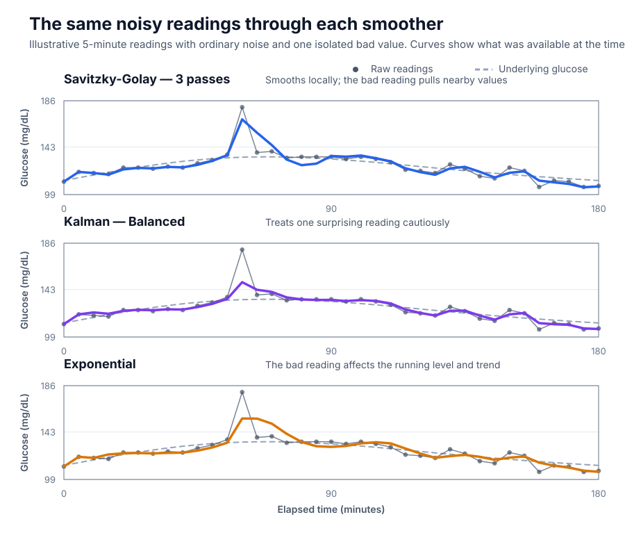
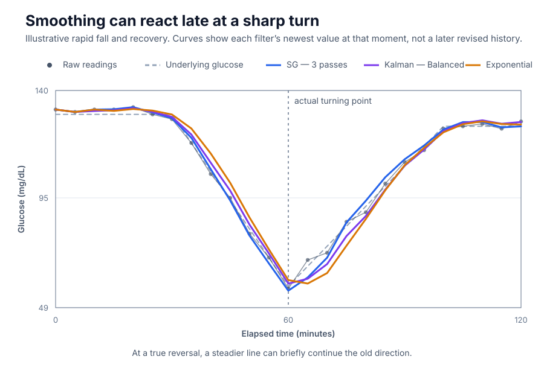
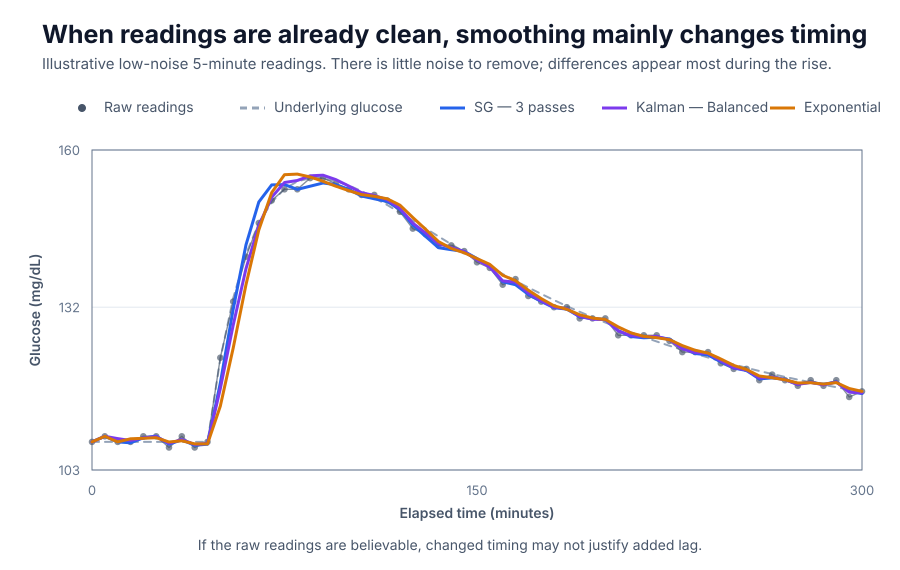
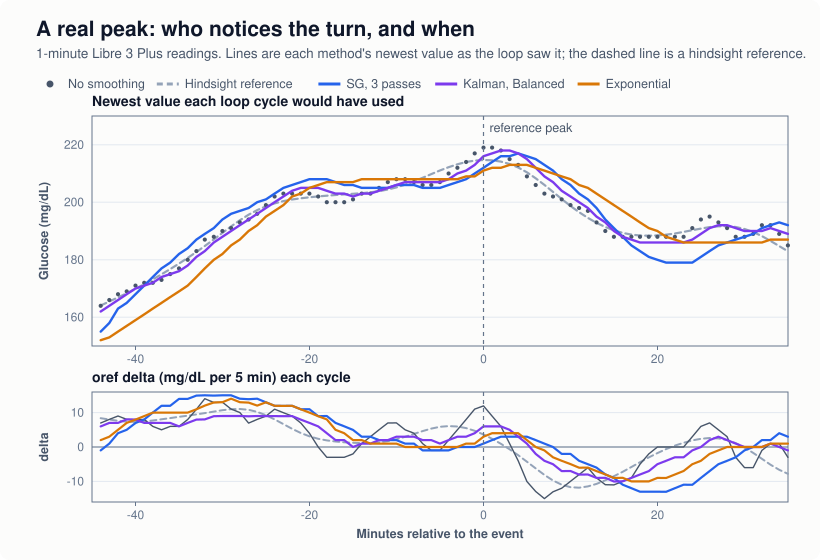
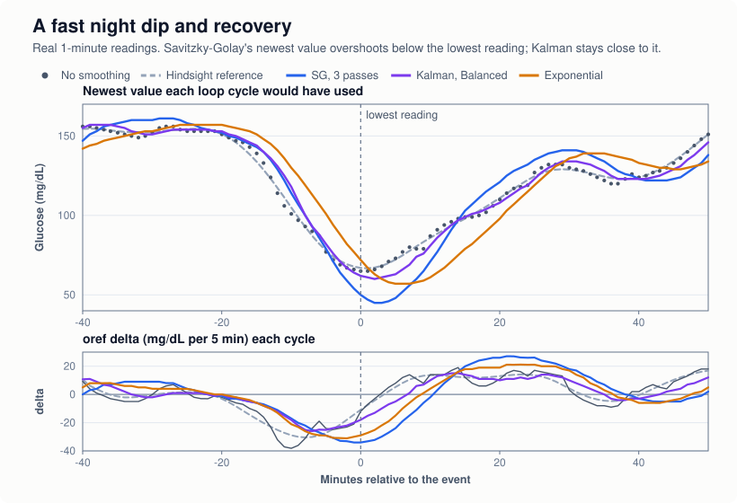

# Glucose smoothing in iAPS

Glucose smoothing reduces small jumps, sensor noise and isolated bad readings before iAPS uses the
readings to calculate insulin. It is not a display option: when smoothing is on, the loop doses from the
smoothed values.

Every smoother has the same trade-off: a calmer line reacts a little later to a real change. No method
can be sure whether a sudden move is sensor noise or real glucose movement.

## The short version

- **Clean, believable readings: choose No smoothing.** It adds no delay. This is the default.
- **You want smoothing and are not sure which: choose Kalman filter, Balanced.** In testing it gave the
  most accurate deltas, both on simulated data and on two months of real Libre 3 Plus readings. It is also the only option that deliberately resists a
  single bad reading.
- **Least delay with a calmer trend: choose Kalman filter, Responsive.** On a clean sensor it had the
  most accurate trend of all the options.
- **Same smoothing as older iAPS: choose Savitzky-Golay, 3 passes.** iAPS selects this for you if you
  had the old switch on. Its newest value lags very little, but its trend is the least reliable of the
  options (see [How they compare](#how-they-compare)).
- **Steadiest line, at the cost of the most lag: choose Exponential.** It never changes a value it has
  already produced.

These suggestions come from simulated data, a few days each of a Dexcom G7, a Libre 2+ and a Libre 3,
and two months of one person's Libre 3 Plus readings. Treat them as a starting point, not a ranking
that holds for every sensor.

## Where to find it

- **Settings → CGM → Smoothing → Algorithm**: No smoothing, Savitzky-Golay, Kalman filter or
  Exponential.
- With Savitzky-Golay you also pick **Passes** (1, 2 or 3; 3 is preselected).
- With Kalman filter you also pick **Responsiveness** (Calm, Balanced or Responsive; Balanced is
  preselected).
- Exponential has no options.

A change applies straight away: the next loop uses the new setting.

## What smoothing changes, and what it does not

iAPS keeps your original readings. Smoothing works on a separate copy.

| Where | Uses |
|---|---|
| The loop | **Smoothed** readings, one roughly every 5 minutes |
| The glucose the loop reports (status, Nightscout device status) | **Smoothed** |
| Main chart | Dots are **smoothed**; raw readings are drawn as a thin grey line with small circles |
| Fingerstick and calibration entries, on the chart and in the loop | Raw, never smoothed |
| Glucose and delta at the top of the home screen | Raw |
| Alarms and notifications, Apple Watch, Live Activity | Raw |
| Bolus calculator's current glucose and delta | Raw |
| Nightscout glucose uploads, Apple Health | Raw |

So the number at the top of the screen can differ by a few mg/dL from the dot drawn under it. Low
alarms still fire on the raw reading, even when the loop is working with a smoothed one.

A few more things to know:

- **Only CGM readings are smoothed.** Fingersticks, calibrations and sensor error values (38 or 39
  mg/dL, see [Terms](#terms)) are passed on unchanged. They are also left out of the calculation, so
  they cannot pull the smoothed readings around them up or down.
- **Smoothed values never go below 40 mg/dL (2.2 mmol/L).** The loop treats 39 and below as sensor
  error codes, not glucose. Without this limit, a smoother overshooting at the
  bottom of a fast fall could turn a real low into an "error", and the loop could stop treating it as
  a low.
- **Smoothed values are rounded to whole mg/dL.** On a quiet sensor many readings come out unchanged,
  so turning smoothing on can look like it did nothing.
- **Savitzky-Golay and Kalman revise recent history.** When a new reading arrives they recalculate the
  last few readings with it, so the recent part of the chart can shift slightly. The newest point has no
  later reading to help it, so it carries the most lag. Exponential never revises an earlier value.

## Terms

- **Raw reading**: the value iAPS receives from the CGM. Many CGMs already filter internally, so "raw"
  does not mean raw sensor data.
- **Lag**: how far behind real glucose changes a smoothed value runs.
- **Outlier**: one reading far from its neighbours, usually a sensor glitch.
- **Sensor session**: iAPS never smooths across a sensor change when the CGM reports when the sensor
  started. A reading without that information (for example a Nightscout backfill) is counted with the
  sensor before it, so it cannot join two sensors together.
- **Error values (38 and 39 mg/dL)**: some data sources send 38 mg/dL (xDrip, when calibration fails)
  or 39 (a "LOW" marker) instead of a reading. iAPS never smooths them: they reach the loop exactly as
  received.

## The choices

### No smoothing

iAPS uses glucose exactly as the CGM reports it.

- **Good:** no added lag; no risk of flattening a real peak or low.
- **Watch out:** noise and single bad readings go straight to the loop, and deltas can jump around on a
  noisy sensor.

### Savitzky-Golay

Savitzky-Golay (SG) fits a smooth curve through the readings in a window of about 30 minutes around
each reading: 7 readings on a 5-minute sensor, 33 on a 1-minute one. Near the newest reading the window
cannot reach forward, so the curve is fitted to the last 30 minutes or so instead.

**Passes** runs the smoothing again over its own result. Each extra pass removes a little more noise,
spreads a spike's effect further and flattens sharp peaks and lows more.

| Passes | Effect |
|---|---|
| **1** | Lightest smoothing |
| **2** | In between |
| **3** | Strongest SG setting; what older iAPS versions always used |

- **Good:** the newest value lags the least of the three methods. Uses real reading times, so missed
  readings and 1-minute or 5-minute data are handled the same way.
- **Watch out:**
  - Its trend at the newest reading is the least reliable of the options. The newest point sits at
    the edge of the fitted curve, so after a turn SG can keep pointing the old way for a few minutes.
    On real Libre 3 Plus readings its delta pointed the wrong way about 1 time in 6 while glucose was
    clearly moving (3 passes; about 1 in 7 with 1 pass), against about 1 in 16 with no smoothing or
    Kalman.
  - At the bottom of a fast, V-shaped dip its newest value can undershoot the lowest reading, by up to
    20 mg/dL in those two months (typically 4).
  - No outlier protection: one bad reading pulls several smoothed values towards it.
  - Starts afresh after a gap longer than 15 minutes or a sensor change. It needs at least 4 readings.

Compared with older iAPS versions, SG now measures its window in minutes rather than in readings.
The old window was 7 readings: 30 minutes on a 5-minute sensor, but only about 6 minutes on a
1-minute one, and it stretched whenever a reading was missed. The old version also made up extra
points past the newest reading and rounded down after every pass, which read about 1.4 mg/dL low on
average. The new version fits real readings only.

### Kalman filter

The Kalman filter keeps a running estimate of two things: the glucose level and how fast it is
changing. It also estimates how noisy your sensor is, from the readings themselves. A single reading
that disagrees with the trend is given less weight. Several surprising readings in the same direction
tell it the trend really has changed.

After the forward run it does a backward pass over the stored readings, so later readings improve the
estimate of earlier ones. The newest reading cannot benefit from this.

**Responsiveness** controls how quickly it gives up its own trend to follow new readings:

| Setting | Effect |
|---|---|
| **Calm** | Smoothest; follows turns most slowly |
| **Balanced** | In between; the default |
| **Responsive** | Follows turns sooner; leaves more wiggle in the line |

- **Good:** the most accurate deltas in testing, on simulated and real data; resists single bad
  readings; works the same with 1-minute and 5-minute readings.
- **Watch out:**
  - Because it distrusts a single surprising reading, a sudden real drop can be followed a reading or
    two late. It can also round off the bottom of a sharp low.
  - During fast rises it reads a little low: about 2 mg/dL (Balanced) on real Libre 3 Plus readings.
  - It joins readings across gaps of up to 60 minutes. That is right when glucose kept moving smoothly,
    and wrong if glucose turned or the sensor's calibration jumped during the gap.
  - Starts afresh after a gap longer than 60 minutes or a sensor change. It needs at least 3 readings.

### Exponential

Exponential smoothing keeps two running averages of the readings: a plain one (40% of the result) and
one that also follows the current trend (60%, called Holt smoothing).

It only ever looks at the current and earlier readings, so it never revises a value once produced.
The price is that its line visibly trails the raw readings.

- **Good:** simple and predictable; stable history; can produce a very steady line.
- **Watch out:**
  - The most lag of the three. During fast rises on real Libre 3 Plus readings it read about 10 mg/dL
    below the sensor (up to 16), so the loop sees a meal rise later.
  - No outlier protection: a spike moves its running level and trend.
  - Its trend can carry on briefly past a real turn, such as the bottom of a fast fall.
  - Starts afresh after a gap of more than 12 minutes or a sensor change, and needs at least 4 readings.

## How they compare

All comparisons here are judged *as it happens*: what the loop actually had at each moment. Judging
the cleaned-up history drawn on the chart afterwards makes SG and Kalman look much better than they
are for dosing, because they revise that history with readings the loop did not have yet.

| | Lag | Single bad reading | Gaps and sensor changes | Revises recent history |
|---|---|---|---|---|
| **No smoothing** | None | Passes straight through | Not applicable | No |
| **Savitzky-Golay** | Lowest for the level, about 1 minute or less; slowest trend at a turn | Spreads it to neighbours | Restarts after 15 min or a sensor change | Yes |
| **Kalman filter** | About 1–2 minutes; more on a very noisy sensor | Mostly resisted | Bridges up to 60 min; restarts at a sensor change | Yes |
| **Exponential** | Highest, about 2.5–4 minutes | Moves level and trend | Restarts after 12 min or a sensor change | No |

On simulated data:

- **Glucose trend (deltas):** Kalman was clearly best. On a noisy sensor its 5-minute deltas were
  about 40% closer to the truth than SG or Exponential, which were similar to each other.
- **Glucose level:** on noisy data Kalman and Exponential were about equal, and both better than SG.
  On very clean data no method improved the level, and Exponential's lag made it the least accurate.
- **A single bad reading, 45 mg/dL too high:** at that moment the smoothed value was still about
  15 mg/dL too high with Kalman, 20 with Exponential and 32–34 with SG.

On two months of real readings from one person's Libre 3 Plus (1-minute readings), scored as the loop
saw them against an after-the-fact estimate of the true curve:

- **No option made the glucose level more accurate.** This sensor's readings arrive already smoothed,
  with no isolated bad readings in the whole period. What smoothing changed was the trend.
- **Trend (deltas):** Kalman was closest to the after-the-fact trend: Responsive 2.3, Balanced 2.5,
  Calm 2.7 mg/dL per 5 minutes, against 2.9 for no smoothing, 3.7 for Exponential and 4.5–4.9 for SG.
- **Calmness:** every option roughly halved how much the delta jumps from one loop cycle to the next.
  Unsmoothed, the delta changed direction about 73 times a day where the underlying trend changed
  about 42 times. Every option brought that down to 41–48.
- **Seeing a turn:** with no smoothing the delta usually showed a turn after about 4 minutes, but it
  flipped back and forth often enough that it sometimes took 19 minutes to settle. Kalman took 6–7
  minutes, SG and Exponential about 8.

The same readings thinned to one every 5 minutes, and a month from an earlier 5-minute source, gave
the same order.

On other sensors, all three removed most of the visible wiggle from a Libre 2+. On a Libre 3 at
1-minute cadence, Exponential left the fewest visible direction changes, at more than twice the
Kalman filter's lag. On a Dexcom G7 there was almost nothing for any of them to remove.

"More smoothing" is not automatically better. A perfectly smooth line can come from removing real
movement as well as noise.

### In pictures

The first three charts use made-up data, so the true glucose curve is known. With a real sensor it is
not, which is why no filter can always tell a bad reading from a real change. Each smoothed line shows
the newest value each filter had at that moment, not the history it revised later.

*One bad reading pulls SG and Exponential well away from the true curve. Balanced Kalman limits its
effect.*

*At a real turn, a smoother can briefly continue in the old direction. That is the cost of being less
willing to react to a single surprising reading.*

*When readings are already clean there is little noise to remove. The visible difference is mostly in
timing around the rise.*

The next two charts use real 1-minute Libre 3 Plus readings. The dashed line is an after-the-fact
estimate drawn with hindsight, not the true glucose.

*A typical real peak. Kalman's delta turns first; SG keeps reporting a rise for a few minutes and then
undershoots the following dip; Exponential trails throughout.*

*A fast overnight dip. SG's newest value goes well below the lowest reading; Kalman stays close to
it.*

## 1-minute and 5-minute sensors

All three methods use the real time between readings. A setting means the same thing at either
cadence: SG's window is about 30 minutes, not a number of readings, and Kalman and Exponential scale
their response to the time between readings. Switching between a 1-minute and a 5-minute source should
not change how strongly smoothing acts.

With a 1-minute sensor, iAPS smooths all the 1-minute readings first and then picks one roughly every
5 minutes for the loop. The extra readings still help the smoothing.

A 1-minute trace also shows more short-term movement, so it can look busier than a 5-minute trace
from the same sensor. Judge it over 20 to 30 minutes, not reading by reading.

## Sensor changes

Smoothing starts afresh at a sensor change, so the old sensor's readings never bend the new sensor's.
The first few readings of the new sensor are smoothed little or not at all.

The loop's trend still compares the new sensor's first readings with the old sensor's last ones. In
the real data above, the new sensor started 25 mg/dL higher than the old one, and with every setting
the loop briefly saw a rise of about 25 mg/dL per 5 minutes. Watch the first loop cycles after a swap.
The new sensor's first 12 hours were also about 40% noisier than the rest of its life.

## Choosing a setting

### Do you need smoothing?

Look at the raw trace over several ordinary days, at 20–30 minute stretches, not neighbouring dots.

Smoothing may help when:

- The trace changes direction repeatedly in small ramps over 10–25 minutes while glucose was probably
  moving steadily.
- It keeps jumping up and down by a few mg/dL during a steady rise or fall.
- You see occasional single readings that immediately snap back.

Smoothing may not help when:

- The raw trace already looks stable and believable.
- Most of the apparent noise is real, fast glucose movement.
- Your CGM or data source already smooths heavily.
- Avoiding any extra delay matters more to you than a smooth line.

### By CGM

The observations below come from a few sensors. They show what a sensor *can* look like, not what
yours will do.

- **Dexcom G7.** Dexcom's own software already filters the readings. The G7 traces we looked at had
  very little noise and almost never changed direction for no reason. Smoothing changed them only
  slightly. **No smoothing** is a reasonable choice. Kalman Balanced can help if occasional single bad
  readings are your problem.
- **Libre 3 / Libre 3 Plus at 1-minute cadence.** Next to a G7 for about 31 hours, a Libre 3 had less
  reading-to-reading noise than the G7, yet changed direction about ten times as often in moves large
  enough to see. Two months of one person's Libre 3 Plus readings looked the same: the readings arrive
  already smoothed and had no single bad readings at all, but the loop's delta changed direction about
  73 times a day against about 42 real turns. The reason to smooth it is that wobble, not bad
  readings. Try **Kalman Responsive** or **Balanced**. On this sensor Savitzky-Golay made the trend
  less reliable than no smoothing.
- **Libre 2+.** Fell between the two.
- **Libre data that is already smoothed.** Some Libre apps and integrations smooth before iAPS
  receives the readings. Adding iAPS smoothing on top doubles the lag. Check your integration's
  settings first.

A trace that looks ragged from one dot to the next is not necessarily noisy, and a smooth-looking one is
not necessarily clean. In our tests the sensor with the least dot-to-dot noise had by far the most
visible direction changes.

### Starting points

| What you want | Start with |
|---|---|
| The CGM signal exactly as it is | **No smoothing** |
| Most accurate trend; protection from single bad readings | **Kalman filter, Balanced** |
| Kalman, reacting a little sooner; least delay with a calmer trend | **Kalman filter, Responsive** |
| Kalman, calmer line, a little more lag | **Kalman filter, Calm** |
| Same as older iAPS smoothing | **Savitzky-Golay, 3 passes** |
| Steadiest line; history never changes | **Exponential** |

### After you turn it on

1. Change one setting at a time.
2. Watch several ordinary days, not one unusually noisy hour.
3. Pay most attention to fast rises, fast falls and the bottom of lows, where lag matters most. The
   loop may react a few minutes later than the raw readings suggest.
4. Compare the smoothed dots with the grey raw line. Don't pick the setting that only looks nicest.
5. If smoothing seems to delay or flatten real changes, choose a lighter setting (Kalman Responsive) or
   turn it off.

**If there is no clear problem in the raw readings, you don't need smoothing.** If there is, Kalman
Balanced is a sensible first try.

## Upgrading from older iAPS

The old **Smooth Glucose Value** switch is replaced by the Algorithm picker. When you upgrade, if the
switch was on, iAPS selects **Savitzky-Golay, 3 passes**, the closest match to what it did. If it was
off, smoothing stays off.

Two cases leave smoothing **off**, so check the setting afterwards:

- **Restoring settings saved by an older iAPS** (for example a backup, or settings text pasted in),
  while this version is already running. Turn smoothing back on.
- **Going back to an older iAPS version.** Older versions do not understand the new setting. Turn the
  old switch on again there.

If a settings file contains a smoothing option this version does not know (for example from a newer
version), only that option goes back to its default; the rest of your smoothing settings are kept.

## How iAPS differs from AndroidAPS

For people comparing the two systems. The Kalman and Exponential methods are adapted from AndroidAPS
(AAPS). The main differences you might notice:

- **Real readings, not a 5-minute grid.** AAPS first turns readings into an even 5-minute series,
  filling gaps of more than 8 minutes with straight-line estimates, and smooths that. iAPS smooths the
  readings as they arrived, at their real times, and picks the 5-minute readings for the loop
  afterwards. A 1-minute sensor's extra readings are not thrown away before smoothing.
- **Kalman filter.** Adapted from the AAPS "Unscented Kalman Filter" plugin, written in a simpler
  form, with slightly different tuning. iAPS estimates sensor noise from the readings each time instead
  of learning it over time, resets cleanly at each sensor change, and pushes back harder on a single
  bad reading. On the same 5-minute real-sensor data, the two agreed to within about 1 mg/dL in testing.
  Calm and Responsive are iAPS additions.
- **Exponential.** Same constants. On regular 5-minute data the result is the same as AAPS. On
  1-minute data iAPS converts the constants to real time, so a 1-minute sensor is smoothed as strongly
  as a 5-minute one instead of about five times more weakly. It also limits the trend part on fast
  sensors, where it would otherwise amplify noise.
- **Savitzky-Golay** is not from AAPS. It continues the smoothing older iAPS versions had.

Advice written for AAPS smoothing plugins does not transfer directly, because iAPS smooths a different
input.

---

Technical details: [glucose-smoothing-dev.md](glucose-smoothing-dev.md)

Writing of this document was assisted by LLMs, based on the current iAPS and AAPS source code,
algorithm porting history and notes, and testing datasets (real CGMs and simulated data).
